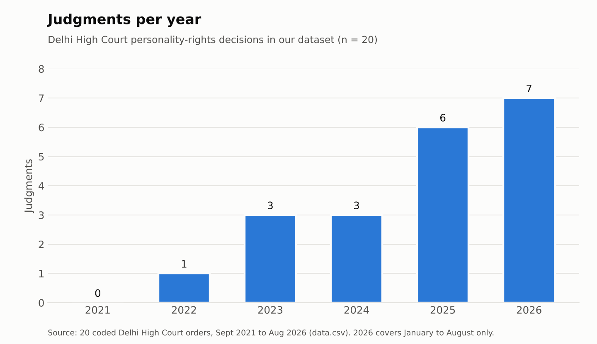
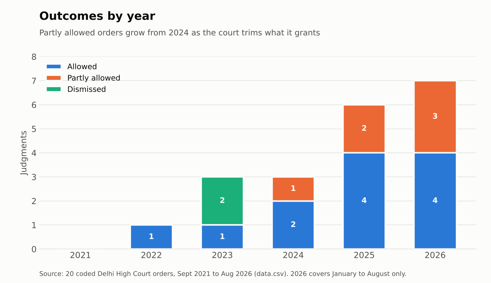
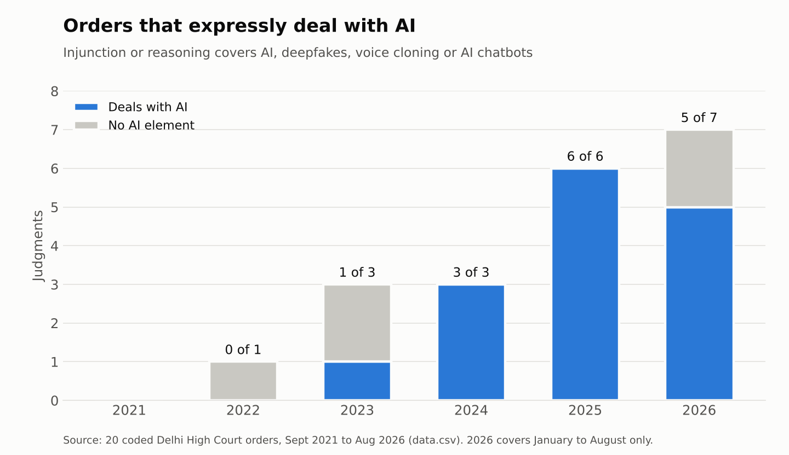

# Personality rights and artificial intelligence in the Delhi High Court, 2021 to 2026

**Project title:** Personality Rights and Artificial Intelligence: A Doctrinal Analysis of Judicial Protection

**Live analysis page:** https://shahnoorsheikh086-art.github.io/Personality-rights-ai-judgments-/

## Team

**Team Persona**

- Shahnoor Sheikh (coded judgments 1 to 7)
- Ankita (coded judgments 8 to 14)
- Tanishkaa (coded judgments 15 to 20)

## Topic

Personality rights let a person control commercial and harmful use of their name, image, voice and other identifying traits. India has no statute on them, so the law has been built almost entirely by judges, mainly in the Delhi High Court. We chose this topic because generative AI has made it cheap to fake a person's face and voice, and we wanted to see how far judge-made law has stretched to meet deepfakes, voice cloning and AI chatbots.

## How we found the judgments

We searched the Delhi High Court judgment portal and Indian Kanoon using the terms "personality rights", "publicity rights", "deepfake", "voice cloning" and "artificial intelligence", limited to decisions between 1 September 2021 and 31 August 2026. Legal news sites (LiveLaw, Bar and Bench, SCC Online Blog) helped us find orders the search missed. This gave well over 50 orders, most of them short celebrity injunctions from 2025 and 2026. We kept reasoned orders only and selected 20 that cover every year with a decision, include every refusal and partial refusal we found, and show the main doctrinal turns. Each judgment was read and coded in the Dataset template, and the source link points to the court's own copy on delhihighcourt.nic.in (for one case, Krishna Kishore Singh, the court's link does not open, so we link to Indian Kanoon). The data is in `data.xlsx` and `data.csv`.

## What the data shows

**Judgments per year.** Our dataset has no decision from late 2021, one in 2022, three each in 2023 and 2024, six in 2025 and seven in only the first eight months of 2026. The rise is real, but it is bigger than our chart shows, because we coded a sample. What surprised us was the speed of the 2025 wave: within a few weeks in September 2025, Aishwarya Rai Bachchan, Abhishek Bachchan, Karan Johar and Nagarjuna all obtained orders.

**Outcomes by year.** Plaintiffs almost always win something: 18 of 20 orders give at least some relief, and the only two outright refusals (the NFT cricket cards case and the Sushant Singh Rajput film case) came in 2023. The trend is in how much relief is given. Partly allowed orders rise from one in 2024 to two in 2025 and three in 2026, as the court protects parody (Karan Johar), fan pages (Hrithik Roshan), political satire (Raghav Chadha) and refuses overbroad blanket orders (Alakh Pandey, Janhvi Kapoor). We did not expect the court to begin limiting the right so soon after expanding it.

**Orders that expressly deal with AI.** Before Anil Kapoor v. Simply Life India (September 2023) no order in our data mentions AI. After it, every 2024 and 2025 order does, usually through a standard clause covering "AI, generative AI, machine learning, deepfakes and face morphing". In 2026 the targets become more specific: AI companion chatbots (Sonakshi Sinha) and a paid voice-cloning tool (Allu Arjun). The two 2026 orders without an AI element are the calibration orders, which deal with how broad a claim can be rather than with technology.

## Limits

Twenty orders are a sample, not every judgment, so the yearly counts reflect our choices as well as the court's docket. Nearly all of these are interim, often ex parte, orders of single judges; none is a final judgment or a Division Bench ruling, so a reader should not treat them as settled law or assume the defendants would lose at trial. The data also cannot tell us whether takedown orders actually worked online.

## AI-use disclosure

We used Claude (Anthropic) to search for candidate judgments, suggest which orders to include, draft the coded entries (including the one-line issue and holding), check each source link and the precedent column against the court's copy, and produce the charts and the analysis webpage (`index.html`). Each team member was responsible for the judgments listed under their name above, reviewed those entries against the official copy, and reworded the issue and holding lines where needed. Where a news report and the official order differed, we followed the official order.
